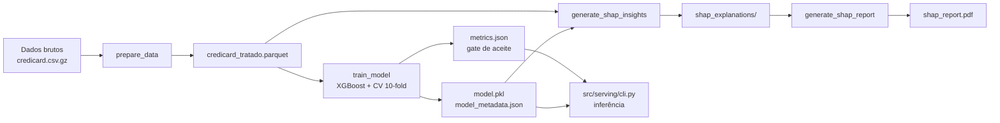
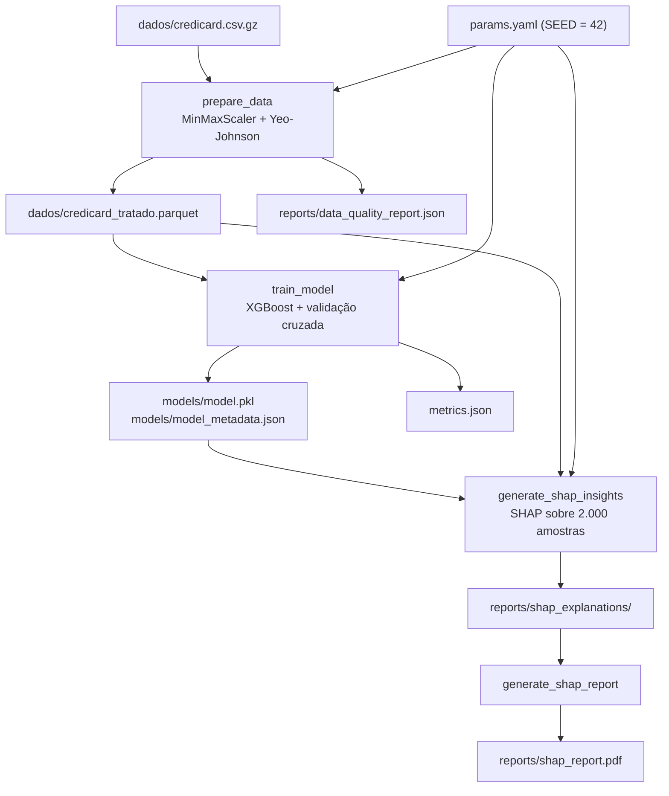

<h1 align="center">🚨 Modelo de Detecção de Fraude em Transações (Credicard — Brasil)</h1>

<p align="center"><i>XGBoost + pipeline DVC reprodutível + explainability SHAP + serving com contrato de inferência validado.</i></p>

<p align="center">
<a href="LICENSE.md"></a>
<a href="https://dagshub.com/flaviohenriquehb777/Modelo_de_Deteccao_de_Fraude-Financeiro"></a>
<a href="https://github.com/flaviohenriquehb777/Modelo_de_Deteccao_de_Fraude-Financeiro/actions/workflows/ci-tests.yml"></a>
<a href="https://dagshub.com/flaviohenriquehb777/Modelo_de_Deteccao_de_Fraude-Financeiro/experiments"></a>
<a href="https://dagshub.com/flaviohenriquehb777/Modelo_de_Deteccao_de_Fraude-Financeiro"></a>
</p>

<p align="center">


</p>

---

## Sumário

- [Status Atual](#-status-atual)
- [Descrição do Modelo](#-descrição-do-modelo)
- [Contexto dos Dados](#-contexto-dos-dados)
- [Arquitetura e Pipeline DVC](#-arquitetura-e-pipeline-dvc)
- [Algoritmos e Técnicas Utilizadas](#-algoritmos-e-técnicas-utilizadas)
- [MLOps e Infraestrutura](#-mlops-e-infraestrutura)
- [SHAP Explainability](#-shap-explainability)
- [Estrutura do Repositório](#-estrutura-do-repositório)
- [Como Reproduzir](#-como-reproduzir)
- [Contrato de Inferência](#-contrato-de-inferência)
- [Métricas do Modelo](#-métricas-do-modelo)
- [Evidências Técnicas](#-evidências-técnicas)
- [Guia do Avaliador](#-guia-do-avaliador)
- [Diferenciais do Projeto](#-diferenciais-do-projeto)
- [Interpretação das Métricas](#-interpretação-das-métricas)
- [Releases](#-releases)
- [Roadmap](#-roadmap)
- [Licença](#-licença)
- [Contato](#-contato)

---

## 🧭 Status Atual

- **Reprodutibilidade verificada:** `dvc repro` executa os 4 estágios e, na segunda execução, retorna `Data and pipelines are up to date.` (pipeline idempotente).
- **Ambiente reprodutível com uv:** as dependências têm versão exata (`==`) no [pyproject.toml](pyproject.toml) e o [uv.lock](uv.lock) congela o grafo transitivo com hashes; `uv sync` recria o ambiente idêntico ao que produziu o [dvc.lock](dvc.lock). O [requirements.txt](requirements.txt) é mantido apenas como espelho para `pip`.
- **Python 3.12:** exigido por `xgboost==3.3.0` e `shap==0.52.0` (`requires-python >= 3.12`). A CI roda no mesmo interpretador usado para gerar o lock.
- **Determinismo:** `SEED = 42` aplicado na validação cruzada, no XGBoost e no SHAP. O preparo de dados é determinístico por construção.
- **Gate de aceite automatizado:** o treino só é aprovado se atingir os critérios de negócio de precisão/recall (ver [Métricas do Modelo](#-métricas-do-modelo)).
- **Higiene de versionamento:** `mlruns/` não é mais rastreado pelo Git; dados, modelo e artefatos SHAP são versionados exclusivamente pelo DVC.
- **Suíte de testes:** 94 testes passando, cobrindo dados, modelo, métricas, contrato de inferência, relatórios públicos e links do README.
- **Qualidade estática:** o `ruff` roda **sem avisos** em `src`, `tests`, `conftest.py` e scripts, e é um **gate obrigatório da CI** (além dos testes e do gate de idempotência do DVC).

---

## 📊 Descrição do Modelo

Modelo de Machine Learning para identificar transações financeiras fraudulentas, otimizando o equilíbrio entre **alta precisão** (evitar bloqueios indevidos de clientes legítimos) e **recall competitivo** (capturar a maior parte das fraudes). O modelo operacional é um **XGBoost** treinado sobre features anonimizadas por PCA, com **explicabilidade completa via SHAP** e **threshold de decisão calibrado por objetivo de negócio**.

---

## 📁 Contexto dos Dados

Base pública de transações de cartão de crédito anonimizadas por PCA (referência *Credit Card Fraud Detection*):

<div align="center">

| Característica | Valor (auditado em `reports/data_quality_report.json`) |
|:---:|:---:|
| Transações (linhas) | 284.807 |
| Colunas | 31 |
| Valores nulos | 0 |
| Taxa de fraude | 0,173% (desbalanceamento extremo) |

</div>

Colunas principais:

- **Time** — segundos decorridos desde a primeira transação.
- **Amount** — valor da transação.
- **Class** — variável-alvo (1 = fraude, 0 = legítima).
- **V1 … V28** — componentes principais do PCA.

> O dataset é tratado como **altamente desbalanceado**, com `scale_pos_weight` calculado automaticamente pelo pipeline.

---

## 🏗️ Arquitetura e Pipeline DVC

### Visão de ponta a ponta



### Grafo do pipeline DVC ([dvc.yaml](dvc.yaml))



### Estágios declarados

<div align="center">

| Estágio | Comando | Entradas (deps) | Saídas (outs / metrics) |
|:---:|:---:|:---:|:---:|
| `prepare_data` | `prepare_data.py` | `dados/credicard.csv.gz`, `params.yaml` | `dados/credicard_tratado.parquet` (out), `reports/data_quality_report.json` (métrica) |
| `train_model` | `train_model.py` | parquet tratado, `params.yaml` | `models/model.pkl`, `models/model_metadata.json` (outs), `metrics.json` (métrica) |
| `generate_shap_insights` | `generate_shap_insights.py` | modelo, metadados, parquet tratado, `params.yaml` | `reports/shap_explanations/` (out, `persist: true`) |
| `generate_shap_report` | `generate_shap_report.py` | `reports/shap_explanations/` | `reports/shap_report.pdf` (out) |

</div>

**Convenção de versionamento:** artefatos pesados (dados, modelo, SHAP) são gravados no DVC e **nunca** no Git. Métricas leves (`cache: false`) permanecem no Git para auditoria direta em qualquer clone.

---

## 🤖 Algoritmos e Técnicas Utilizadas

**Modelo operacional**
- **XGBoost** (`max_depth=7`, `n_estimators=300`, `learning_rate=0.1`, `scale_pos_weight` automático)

**Algoritmos avaliados na fase experimental**
- Logistic Regression, Random Forest, Support Vector Classifier (SVC)

**Técnicas de balanceamento exploradas**
- Under-sampling: RandomUnderSampler, ClusterCentroids, NearMiss
- Over-sampling: RandomOverSampler, SMOTE

**Outras técnicas**
- Normalização: `MinMaxScaler` (Time) + `PowerTransformer Yeo-Johnson` (Amount)
- Validação cruzada estratificada de 10 folds
- `GridSearchCV` para otimização de hiperparâmetros
- Busca automática de threshold por *business gap* ponderado
- Rastreamento de experimentos com MLflow
- **SHAP** para explainability

---

## 🚀 MLOps e Infraestrutura

- **Versionamento com DVC:** dados, modelo e explicações SHAP são reconstruíveis via `dvc pull` / `dvc repro`; o [dvc.lock](dvc.lock) é a fonte de verdade dos hashes.
- **Reprodutibilidade com versões fixas:** o ambiente é gerenciado pelo [uv](https://docs.astral.sh/uv/) — versões `==` no [pyproject.toml](pyproject.toml) e hashes no [uv.lock](uv.lock); a CI sincroniza com `uv sync --frozen` em Python 3.12.
- **MLflow + DagsHub:** experimentos históricos, métricas e modelos registrados publicamente para auditoria técnica.
- **GitHub Actions ([ci-tests.yml](.github/workflows/ci-tests.yml)):** instala o ambiente com `uv sync --frozen`, valida as dependências (`uv pip check`), roda o lint (`ruff check .`), baixa artefatos (`dvc pull`), roda a suíte de testes e executa um **gate de idempotência** (`dvc repro` → `dvc status` deve reportar *up to date*).
- **Releases versionadas ([publish-release.yml](.github/workflows/publish-release.yml)):** separam explicitamente a entrega original das atualizações posteriores.
- **Serviço de inferência:** interface CLI versionada em [src/serving/cli.py](src/serving/cli.py), com validação de contrato *fail-closed*.

---

## 🔍 SHAP Explainability

Artefatos gerados por `generate_shap_insights` e consolidados por `generate_shap_report`:

- **Summary Plots** — importância global das features
- **Feature Importance / Ranking** — ordenação por contribuição
- **Dependence Plots** — relação entre valor da feature e impacto
- **Force Plots** — explicação individual por transação
- **Relatório PDF executivo** — síntese para stakeholders

**Insights (última execução auditada):** feature mais relevante = **V14**; top features incluem **V12, V10, V16, V17** (configurado para ranquear as 6 principais).

---

## 📂 Estrutura do Repositório

```text
Modelo_de_Deteccao_de_Fraude-Financeiro/
├── .dvc/                                  # Configuração do DVC (config.local fora do Git)
├── .github/workflows/
│   ├── ci-tests.yml                       # Lint + testes + gate de idempotência do DVC
│   └── publish-release.yml                # Publicação automática de releases
├── .dvcignore                             # Padrões ignorados pelo DVC
├── .gitignore                             # Padrões ignorados pelo Git
├── dados/                                 # Dados versionados pelo DVC
│   ├── credicard.csv.gz.dvc               # Ponteiro do dado bruto
│   └── .gitignore
├── docs/
│   ├── environment-setup.md               # Setup limpo de ambiente
│   ├── evaluator-guide.md                 # Passo a passo para o avaliador
│   └── release-update-draft.md            # Draft da release de atualização
├── models/
│   ├── best_model_xgboost.reference.json  # Referência histórica (versionada no Git)
│   └── .gitignore
├── notebooks/                             # Histórico de experimentação (10 notebooks)
├── reports/
│   ├── data_quality_report.json           # Métrica do DVC (cache: false)
│   ├── mlflow_public_registry_summary.json
│   ├── production_readiness_scorecard.json
│   ├── shap_explanations/                 # Out do DVC (persist: true)
│   ├── shap_report.pdf                    # Out do DVC
│   └── .gitignore
├── src/
│   ├── config/
│   │   ├── __init__.py
│   │   ├── paths.py                       # Fonte única de caminhos do projeto
│   │   ├── prepare_data.py                # Estágio 1: saneamento e transformação
│   │   ├── train_model.py                 # Estágio 2: CV, calibração e gate de aceite
│   │   ├── generate_shap_insights.py      # Estágio 3: SHAP
│   │   ├── generate_shap_report.py        # Estágio 4: relatório PDF
│   │   ├── generate_mlflow_public_summary.py
│   │   ├── generate_production_readiness_scorecard.py
│   │   ├── modelos.py
│   │   ├── auxiliares.py
│   │   ├── auxiliares_ml.py
│   │   └── graficos.py
│   └── serving/
│       ├── __init__.py
│       ├── inference.py                   # Carga do bundle, validação e previsão
│       └── cli.py                          # Interface oficial de inferência
├── tests/                                 # 94 testes automatizados
├── LICENSE.md
├── README.md
├── conftest.py                            # Garante o projeto no sys.path nos testes
├── dvc.lock                               # Hashes dos 4 estágios
├── dvc.yaml                               # Definição do pipeline
├── metrics.json                           # Métrica do DVC (cache: false)
├── params.yaml                            # Parâmetros oficiais (inclui SEED = 42)
├── pyproject.toml                         # Metadados e dependências (PEP 621)
├── uv.lock                                # Lock reprodutível (transitivas + hashes)
├── .python-version                        # Python fixado (3.12)
├── pytest.ini
└── requirements.txt                       # Dependências (espelho para pip)
```

> **Convenção de artefatos:** o pipeline operacional usa `models/model.pkl`. A referência histórica do melhor modelo experimental é preservada em `models/best_model_xgboost.reference.json`, sem ponteiro DVC órfão.

---

## 💻 Como Reproduzir

### Pré-requisitos

- **Python 3.12** (exigido por `xgboost==3.3.0` / `shap==0.52.0`; fixado em [.python-version](.python-version))
- [**uv**](https://docs.astral.sh/uv/) — gerenciador de ambiente e dependências
- `git`
- Acesso ao remoto DVC (DagsHub) para `dvc pull`

### Passo a passo

```bash
# 1. Clone o repositório
git clone https://github.com/flaviohenriquehb777/Modelo_de_Deteccao_de_Fraude-Financeiro.git
cd Modelo_de_Deteccao_de_Fraude-Financeiro

# 2. Sincronize o ambiente a partir do lock (cria .venv e instala tudo)
uv sync

# 3. Baixe dados e artefatos versionados
uv run dvc pull

# 4. Reproduza o pipeline completo (idempotente)
uv run dvc repro
```

> **Alternativa com pip:** o `requirements.txt` é mantido como espelho das dependências
> fixadas. Nesse caso use `python -m venv .venv && pip install -r requirements.txt`.

Se o `dvc pull` solicitar autenticação, configure as credenciais localmente (sem versionar segredos):

```bash
uv run dvc remote modify --local dagshub auth basic
uv run dvc remote modify --local dagshub user <seu_usuario_dagshub>
uv run dvc remote modify --local dagshub password <seu_token_dagshub>
```

### Executando estágios individuais

```bash
uv run dvc repro prepare_data            # saneamento e transformação
uv run dvc repro train_model             # treino, calibração e gate de aceite
uv run dvc repro generate_shap_insights  # explicações SHAP
uv run dvc repro generate_shap_report    # relatório PDF
```

### Testes e verificação de reprodutibilidade

```bash
uv run pytest -q                        # suíte completa (94 testes)
uv run ruff check .                     # lint sem avisos (zero warnings)
uv run dvc repro && uv run dvc status   # deve reportar "Data and pipelines are up to date."
```

> **Interpretando o gate de idempotência:** se a segunda execução de `dvc repro` não alterar nenhum estágio e `dvc status` reportar *up to date*, o ambiente fixado reproduz exatamente os hashes do `dvc.lock` — ou seja, a reprodutibilidade está comprovada.

---

## 🔌 Contrato de Inferência

Interface oficial: **`python -m src.serving.cli`**

```bash
uv run python -m src.serving.cli \
  --input dados/credicard_tratado.parquet \
  --output reports/predictions.csv \
  --format csv \
  --limit 100
```

**Argumentos**

<div align="center">

| Argumento | Obrigatório | Descrição |
|:---:|:---:|:---:|
| `--input` | Sim | Arquivo `.csv` ou `.parquet` com as features de entrada |
| `--output` | Sim | Arquivo de saída `.csv` ou `.json` |
| `--format` | Não | `csv` (padrão) ou `json` |
| `--limit` | Não | Limita as linhas processadas (útil para smoke tests) |

</div>

**Entrada**

- Deve conter **exatamente as 30 features exigidas pelo modelo**: `Time`, `V1` … `V28`, `Amount` (nomes expostos por `model.feature_names_in_`).
- A coluna `Class` é **ignorada automaticamente** se presente.
- **Comportamento *fail-closed*:** se qualquer feature obrigatória estiver ausente, a execução **falha com `ValueError`**, em vez de gerar previsões silenciosamente incorretas. Colunas extras são descartadas e a ordem é reordenada conforme o modelo.

**Saída**

<div align="center">

| Coluna | Descrição |
|:---:|:---:|
| `fraud_probability` | Probabilidade de fraude (0–1) |
| `fraud_prediction` | Decisão binária aplicando o threshold oficial (1 = fraude) |
| `decision_threshold` | Threshold efetivamente usado na decisão |

</div>

**Threshold oficial:** lido de `models/model_metadata.json` (chave `decision_threshold`), garantindo que treino e serving usem o **mesmo ponto de corte** — evitando divergência silenciosa entre avaliação e produção.

---

## 📈 Métricas do Modelo

### Pipeline operacional (reproduzível e auditável)

Valores de `metrics.json` gerados pela última execução do pipeline:

<div align="center">

| Métrica | Valor |
|:---:|:---:|
| Threshold oficial | **0,566** |
| Precisão (out-of-fold calibrada) | **96,11%** |
| Recall (out-of-fold calibrado) | **80,28%** |
| Acurácia | 99,96% |
| Precisão média (CV 10-fold) | 96,25% |
| Recall médio (CV 10-fold) | 80,28% |
| *Business weighted gap* | 0,0050 |

</div>

### Gate de aceite (bloqueia regressão)

O treino só é considerado aprovado se **todos** os critérios forem satisfeitos:

<div align="center">

| Critério | Limite | Resultado |
|:---:|:---:|:---:|
| `min_cv_precision` | ≥ 0,94 | ✅ |
| `min_cv_recall` | ≥ 0,78 | ✅ |
| `min_calibrated_precision` | ≥ 0,96 | ✅ |
| `min_calibrated_recall` | ≥ 0,80 | ✅ |
| `max_business_weighted_gap` | ≤ 0,02 | ✅ (0,0050) |

</div>

**Status do gate: PASS** — `acceptance.passed = true`.

### Meta aspiracional 96/82 (não bloqueante)

A meta de negócio **bloqueante** é **96/80** (precisão ≈ 96% mantendo recall > 80%). A meta **96/82 simultânea** é tratada como **aspiracional**: medida sobre a fronteira honesta out-of-fold, ela é **inalcançável** sem deteriorar a precisão (com `recall ≥ 0,82`, a precisão máxima observada é **0,9140**). Por isso ela **não** entra no gate — é apenas reportada em `metrics.json` (`aspirational_target`) e no scorecard, com o gap explícito.

<div align="center">

| Meta aspiracional | Valor |
|:---:|:---:|
| Alvo (`aspirational_precision` / `aspirational_recall`) | 0,96 / 0,82 |
| Melhor ponto factível (`recall ≥ 0,82`) | P **0,9140** · R **0,8211** |
| Gap de precisão (`0,96 − 0,9140`) | **0,0460** |
| Simultaneamente alcançável? | ❌ (bloqueio aplicado apenas a 96/80) |

</div>

> **Por que não endurecer o gate para 96/82?** Seria um gate que **reprova sempre** (CI vermelha permanente). A escolha sênior é preservar o eixo de negócio crítico (precisão) e o recall mínimo, documentando o trade-off — **nunca** inflar métricas com vazamento de dados para forçar 96/82.

### Baseline legado (referência histórica)

<div align="center">

| Métrica | Valor | Fonte |
|:---:|:---:|:---:|
| Precisão | 92,27% | baseline legado — `models/best_model_xgboost.reference.json` |
| Recall | 81,02% | baseline legado — `models/best_model_xgboost.reference.json` |

</div>

> **Como ler as duas tabelas:** o *baseline legado* é o melhor XGBoost do projeto histórico, preservado em `models/best_model_xgboost.reference.json` (`business_baseline`: `precision = 0.9227`, `recall = 0.8102`). Ele é **distinto** do alvo de negócio da Fase 4 em `params.yaml` (`target_precision = 0.96`, `target_recall = 0.80`) e do run público auditável descrito em *MLflow e DagsHub Públicos*. O *pipeline operacional* é a versão automatizada que reproduz o patamar de forma auditável, com desvio ponderado de apenas **0,0050** (0,50 p.p.) em relação ao alvo de 0,96/0,80.

---

## 🧪 Evidências Técnicas

- **Pipeline versionado:** [dvc.yaml](dvc.yaml) · **[dvc.lock](dvc.lock)**
- **Integração contínua:** [ci-tests.yml](.github/workflows/ci-tests.yml)
- **Publicação de releases:** [publish-release.yml](.github/workflows/publish-release.yml)
- **Métricas operacionais:** [metrics.json](metrics.json)
- **Qualidade dos dados:** [reports/data_quality_report.json](reports/data_quality_report.json)
- **Resumo público de MLflow/DagsHub:** [mlflow_public_registry_summary.json](reports/mlflow_public_registry_summary.json)
- **Scorecard de prontidão:** [production_readiness_scorecard.json](reports/production_readiness_scorecard.json)
- **Experimentação histórica:** [09_777_MLFlow_Deployment.ipynb](notebooks/09_777_MLFlow_Deployment.ipynb)
- **Experimentos públicos no DagsHub:** [Experiments](https://dagshub.com/flaviohenriquehb777/Modelo_de_Deteccao_de_Fraude-Financeiro/experiments)
- **Modelo público registrado no DagsHub:** [Models](https://dagshub.com/flaviohenriquehb777/Modelo_de_Deteccao_de_Fraude-Financeiro/models)

## 🌐 MLflow e DagsHub Públicos

- **Experimento público principal:** `Fraud Detection XGBoost Experiment` (`experiment_id = 0`)
- **Best-model histórico público:** `Treinamento do Modelo - XGBoost Otimizado` (`model_id = m-695031f059db422fb7c12c7e47ef58e9`)
- **Métricas históricas auditáveis (run público):** `run_id = a26402d536734886aa1c26f42903f9e4` → `precision = 0.962025`, `recall = 0.775510`, `accuracy = 0.999561`
- **Modelo operacional atual:** XGBoost `max_depth=7`, `n_estimators=300`, `learning_rate=0.1`, `random_state=42` (`scale_pos_weight` automático) — alinhado a [metrics.json](metrics.json)
- **Execuções visíveis para avaliadores:** `7` runs públicos no DagsHub
- **Registry público visível:** `1` modelo registrado publicamente no DagsHub
- **Log de execução local (opt-in):** `uv run python src/config/train_model.py --mlflow` registra o modelo final, o threshold e os metadados no `mlruns/` local (fora do gate DVC/CI)

---

## 🧭 Guia do Avaliador

### Avaliação em 3 minutos

1. Leia a [Arquitetura e Pipeline DVC](#-arquitetura-e-pipeline-dvc) deste README.
2. Abra [dvc.yaml](dvc.yaml) e [params.yaml](params.yaml) para ver o contrato do pipeline e os parâmetros.
3. Consulte [metrics.json](metrics.json) e confirme `acceptance.passed = true`.
4. Verifique a suíte automatizada em [.github/workflows/ci-tests.yml](.github/workflows/ci-tests.yml).
5. Abra os [Experiments](https://dagshub.com/flaviohenriquehb777/Modelo_de_Deteccao_de_Fraude-Financeiro/experiments) e os [Models](https://dagshub.com/flaviohenriquehb777/Modelo_de_Deteccao_de_Fraude-Financeiro/models) públicos no DagsHub.

### Documentos de apoio

- **Passo a passo detalhado:** [docs/evaluator-guide.md](docs/evaluator-guide.md)
- **Setup limpo de ambiente:** [docs/environment-setup.md](docs/environment-setup.md)
- **Draft da release de atualização:** [docs/release-update-draft.md](docs/release-update-draft.md)

---

## ✨ Diferenciais do Projeto

- **Pipeline DVC idempotente** com 4 estágios, hashes íntegros e gate de reprodutibilidade na CI.
- **Ambiente 100% reproduzível com uv** — lock com hashes, versões fixadas e Python 3.12 alinhado entre desenvolvimento e CI.
- **Determinismo explícito** — `SEED = 42` único em todas as etapas estocásticas.
- **Gate de aceite por métrica de negócio** — o treino falha se a precisão/recall caírem abaixo do alvo.
- **Serving com contrato *fail-closed*** — não há "falha silenciosa": entradas ambíguas derrubam o processo.
- **Explainability completa (SHAP)** com relatório executivo em PDF.
- **Histórico preservado** — a entrega original permanece nas tags `snapshot` e `v1.0.0`.

---

## 🎯 Interpretação das Métricas

- **Alta Precisão (~96,2%)** → poucas transações legítimas são bloqueadas; reduz atrito com o cliente e custo de atendimento.
- **Recall (~80,3%)** → captura a maior parte das fraudes, aceitando uma perda controlada em favor da experiência do cliente.
- **Acurácia (~99,96%)** → alta, porém pouco informativa isoladamente em datasets com 0,17% de positivos.
- **Threshold calibrado por *business gap*** → o ponto de corte é escolhido minimizando um erro ponderado (precisão com peso 2×), não o padrão 0,5 por inércia.

---

## 🏷️ Releases

- [snapshot — Entrega original (referência)](https://github.com/flaviohenriquehb777/Modelo_de_Deteccao_de_Fraude-Financeiro/releases/tag/snapshot)
- [v1.0.0 — Entrega original do modelo](https://github.com/flaviohenriquehb777/Modelo_de_Deteccao_de_Fraude-Financeiro/releases/tag/v1.0.0)
- [v1.1.0 — Rename + DagsHub/DVC/CI](https://github.com/flaviohenriquehb777/Modelo_de_Deteccao_de_Fraude-Financeiro/releases/tag/v1.1.0)
- [v1.2.0 — Production Hardening Update](https://github.com/flaviohenriquehb777/Modelo_de_Deteccao_de_Fraude-Financeiro/releases/tag/v1.2.0)
- [v1.3.0 — Reprodutibilidade e hardening](https://github.com/flaviohenriquehb777/Modelo_de_Deteccao_de_Fraude-Financeiro/releases/tag/v1.3.0)
- [v1.4.0 — Ambiente uv e README](https://github.com/flaviohenriquehb777/Modelo_de_Deteccao_de_Fraude-Financeiro/releases/tag/v1.4.0)
- [v1.5.0 — Governança, CI e release](https://github.com/flaviohenriquehb777/Modelo_de_Deteccao_de_Fraude-Financeiro/releases/tag/v1.5.0)

> A entrega histórica segue explicitamente preservada pelas tags `snapshot` e `v1.0.0`; nenhum commit do histórico original foi reescrito.

---

## 🛣️ Roadmap

- **Fases 1–9** — Diagnóstico, narrativa, higienização, reprodutibilidade, hardening, testes, serving, MLflow/DagsHub e polimento: concluídas
- **Fase 10 — Entrega Oficial do Update:** concluída (release v1.2.0)
- **Fase 11 — Reprodutibilidade de Nível Sênior:** concluída (release v1.3.0) — versões fixadas, Python 3.12 na CI, gate de idempotência do DVC, `mlruns` fora do Git e README reconstruído
- **Fase 12 — Ambiente de nível sênior com uv:** concluída (release v1.4.0) — [pyproject.toml](pyproject.toml) (PEP 621) + [uv.lock](uv.lock) com hashes, Python 3.12 fixado em [.python-version](.python-version) e CI migrada para `uv sync --frozen`
- **Fase 13 — Governança, CI e release:** concluída (release v1.5.0) — `ruff` sem avisos e como gate obrigatório na CI, notebooks higienizados (sem saídas/execução) e documentação revisada

---

## 📜 Licença

Este repositório está licenciado sob a **Licença MIT**. Consulte [LICENSE.md](LICENSE.md).

---

<h2 align="center">📬 Contato</h2>

<div align="center">

| Nome | LinkedIn | E-mail | DagsHub |
|:---:|:---:|:---:|:---:|
| Flávio Henrique Barbosa | [flávio-henrique-barbosa](https://www.linkedin.com/in/fl%C3%A1vio-henrique-barbosa-38465938) | [flaviohenriquehb777@outlook.com](mailto:flaviohenriquehb777@outlook.com) | [flaviohenriquehb777](https://dagshub.com/flaviohenriquehb777) |

</div>
